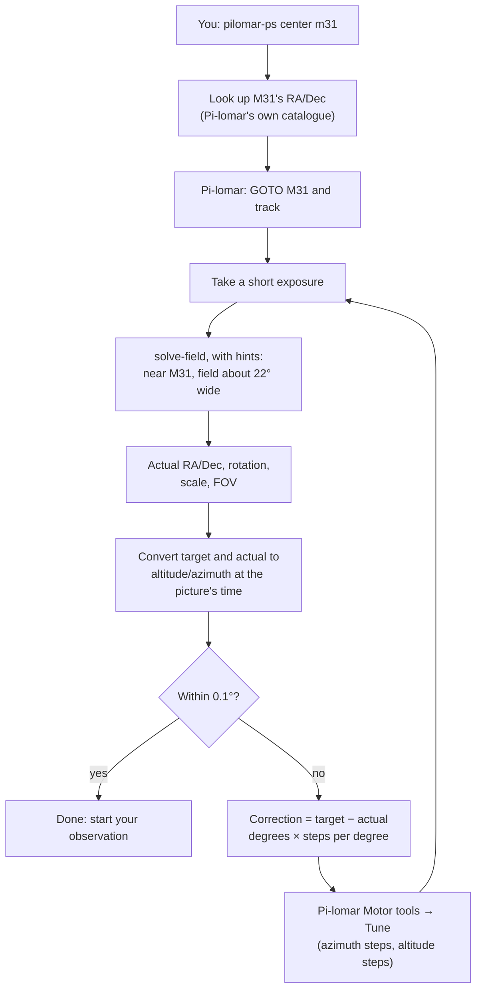

# pilomar-platesolve

Plate solving and automatic target centring for the
[Pi-lomar](https://github.com/Short-bus/pilomar) 3D-printed miniature observatory.

You say *"centre the Andromeda Galaxy"*. The Pi takes a picture, works out from
the stars exactly where the camera is pointing, compares that with where
Andromeda really is, nudges the motors by the difference, and repeats until the
galaxy is in the middle of the frame. Everything runs on the Raspberry Pi with
no internet connection.

It is an **add-on**, not a fork: it lives in its own folder, never edits a
Pi-lomar file, and keeps working when you update Pi-lomar.

Example output (from the built-in simulator, starting 1.5° out in azimuth and 0.8° in altitude):

```
$ pilomar-ps center m31
Centring m31 Andromeda Galaxy: now at altitude 76.5°, azimuth 300.7°

[1] Capturing...
  RA   (centre) : 00h 39m 29.88s   (9.8745°)
  Dec  (centre) : +41° 53' 48.5"   (+41.8968°)
  Rotation      : 20.00° (image top, east of north)
  Field of view : 22.20° x 16.64°  (diagonal 27.74°)
  Plate scale   : 39.40"/pixel  (2028 x 1520 px)
    off by 0.872°: 0.603° too far west, 0.630° too far north  |  needs azimuth -1.507°, altitude +0.794°

  >>> In Pi-lomar: Motor tools (21)
      Tune azimuth position  (4): enter -1447  then 'x'
      Tune altitude position (5): enter +762  then 'x'
...
  ✔ centred to 0.038° (tolerance 0.1°) in 3 picture(s)
```

---

## How plate solving works

1. **Take a picture of the stars.** A few seconds of exposure with the HQ
   camera is enough to capture dozens of stars.
2. **Find the stars and match the pattern.** The solver
   ([astrometry.net](https://astrometry.net)) finds every star in the picture,
   takes groups of four, and describes the *shape* of each group with numbers
   that don't change when the picture is moved, rotated or scaled. It looks
   those shapes up in index files built from a star catalogue (2MASS), like
   recognising a constellation by its shape whatever way up you hold the map.
3. **Work out exactly where the camera is pointing.** Once a few groups match,
   the solver knows which real star each dot is. It then fits a *World
   Coordinate System* (WCS): a formula that turns any pixel into a sky
   position. From the WCS this tool reports:

| Value | Meaning | Typical for HQ camera + 16 mm lens |
|---|---|---|
| **Right Ascension (RA)** | Celestial longitude of the image centre (J2000) | – |
| **Declination (Dec)** | Celestial latitude of the image centre | – |
| **Rotation** | Direction the top edge of the image points, measured from north towards east. On an alt-az mount like Pi-lomar this changes as a target crosses the sky (field rotation). | changes during the night |
| **Field of view (FOV)** | How much sky the picture covers | 22.2° × 16.7° |
| **Plate scale** | How much sky one pixel covers | ~20″/px at full resolution (4056 px wide), ~39″/px at 2028 px |
| **Mirrored** | Whether the image is flipped left-to-right | should be "no" |

Because we already know roughly where the camera points (Pi-lomar's GOTO) and
how big the field is (the lens), the solver is given both as hints. That cuts a
blind search of the whole sky (minutes) down to a few seconds on a Pi 5.

## How this fits with Pi-lomar

Pi-lomar already has pieces of this, and the add-on is built around them:

| Pi-lomar already has | What this add-on adds |
|---|---|
| `scripts/astrometry.net` installs `solve-field` and the 2MASS index files from apt | Uses that same installation: nothing extra to download |
| `src/pilomarplatesolve.py` solves a picture and reports where it was pointing | Turns that answer into a **correction** and applies it, in a loop, until the target is centred |
| GOTO + tracking that follows the target through the night | Nothing changed: Pi-lomar still does all the slewing and tracking |
| **Motor tools → Tune azimuth/altitude position**, which moves a motor *without* changing Pi-lomar's idea of where it is pointing (the optical drift tracker uses the same function) | Applies plate-solve corrections through Tune, so they stay in effect while Pi-lomar keeps tracking |

### The centring loop



The motors move in altitude and azimuth, so the error is converted into those
two axes at the moment the picture was taken. A pointing error from imperfect
homing or levelling stays fixed in the motor frame, so once Tune has removed it
Pi-lomar's normal tracking keeps the target centred.

Safety built into the loop:
* applies 90% of each correction so backlash doesn't make it overshoot
* limits a single move to 10°
* stops and tells you if the error gets *bigger* after corrections, which almost
  always means an axis direction (`az_sign` / `alt_sign`) is reversed
* if a solve with hints fails, retries once with no position hint (a "blind" solve)
* logs every solve to `~/pilomar-platesolve/data/pointing_log.csv`

### Why it won't conflict with Pi-lomar updates

* **Separate folder.** It installs to `~/pilomar-platesolve`, never inside
  `/home/pi/pilomar`, so `git pull` in Pi-lomar never touches it.
* **Read-only.** It *reads* `data/pilomar_params.json` (for your home
  latitude and longitude) and `data/messierobjects.json` / `data/ngc.json` (for
  target names), and the pictures Pi-lomar saves. It writes only into its own
  `data` folder. A test checks that the parameter file is left untouched.
* **No shared Python environment.** It uses only the Python standard library,
  so it can't break Pi-lomar's packages (or be broken by them).
* **No code hooks.** It does not import or patch Pi-lomar's code. All Pi-lomar
  knowledge sits in one small file (`pilomar_platesolve/pilomar_bridge.py`), and
  if a future Pi-lomar renames something it reports what's missing instead of
  crashing.
* **It never uses the camera or motors behind Pi-lomar's back.** It either waits
  for pictures Pi-lomar saves, or uses the camera only when you've told it to.
  Motor moves go through Pi-lomar's own Tune menu.

## Ways of working

Two settings decide how hands-off it is:

| `capture.source` | Where pictures come from |
|---|---|
| `pilomar-folder` (default) | Waits for the next picture Pi-lomar saves (preview frames or observation lights) in `data/campaign_*/` |
| `rpicam` | Takes its own exposure with `rpicam-still`. Only while Pi-lomar isn't holding the camera |

| `mount.backend` | How corrections are applied |
|---|---|
| `advisor` (default) | Prints the exact Tune steps to type into Pi-lomar. Zero risk; best for the first nights |
| `tmux` | Types those steps into Pi-lomar for you. Pi-lomar must be running inside `tmux`. **Experimental** (see below) |

Start with `advisor` + `pilomar-folder`. Once the numbers look right, switch to
`tmux` for hands-free centring.

## Installing on the Pi

```bash
cd ~
git clone https://github.com/<your-account>/pilomar-platesolve.git
cd pilomar-platesolve
./install.sh
```

`install.sh` installs `astrometry.net`, `astrometry-data-2mass-08-19` and `tmux`
from apt if they're missing, creates the `pilomar-ps` command and a
`config.json`, then runs `pilomar-ps check`.

The `astrometry-data-2mass-08-19` index package is the one Pi-lomar recommends
for 16 mm to 50 mm lenses on the HQ camera. If you fit a different lens,
change `optics.focal_length_mm` in `config.json`.

## Using it: centring Andromeda

1. Start Pi-lomar as usual (inside tmux if you want automatic Tune):
   ```bash
   tmux new -s pilomar 'cd /home/pi/pilomar/src && ./pilomar'
   ```
   Detach with `Ctrl+B` then `D`; come back with `tmux attach -t pilomar`.
2. In Pi-lomar select M31 and **GOTO** it (main menu 4). Set an exposure that
   shows stars (main menu 6, e.g. 2–5 s).
3. In a second terminal: `pilomar-ps center m31`
4. Each time it says *"Waiting for Pi-lomar to save a new picture"*, take a
   preview frame in Pi-lomar (main menu 13). In `advisor` mode, type the Tune
   steps it prints into Motor tools (21) and press Enter.
5. When it reports **centred**, start your observation in Pi-lomar as normal.

Other commands:

```bash
pilomar-ps check                       # is everything installed and found?
pilomar-ps suggest                     # bright deep-sky targets up right now (avoids the Moon)
pilomar-ps target andromeda            # where is it now?
pilomar-ps solve path/to/image.jpg     # where was this picture pointing?
pilomar-ps solve image.jpg --target m31   # ...and how far from M31?
pilomar-ps watch --target m31          # solve every picture Pi-lomar saves; shows drift
pilomar-ps simulate m31 --az 1.5 --alt -0.8   # run the whole loop with a virtual mount
pilomar-ps config                      # show all settings
```

Targets can be Messier or NGC numbers (`m31`, `M 31`, `NGC 7000`), names
(`andromeda`, `orion nebula`) or coordinates (`10.68 41.27` or `00:42:44 +41:16:09`).

## Testing it step by step

| Stage | Command | Needs |
|---|---|---|
| 1. Software | `python3 -m unittest discover -s tests` | any computer |
| 2. Whole loop | `pilomar-ps simulate m31` (try `--wrong-sign`, `--fail 1`) | any computer |
| 3. Solver | `pilomar-ps solve` on a star picture you've already taken | Pi, no sky |
| 4. Live, by hand | `pilomar-ps center <target>` with `advisor` | clear night |
| 5. Hands-free | `mount.backend = "tmux"`, first with `--dry-run` | clear night |

**Before trusting `tmux` mode**, check one thing by hand: in Pi-lomar, Motor
tools (21) → 4 should ask *"Azimuth steps to move (+/-), 'x' to exit"*, and 5 the
same for altitude. Also check what key leaves Motor tools for the main menu. The
keystrokes are in `mount.tmux.tune_keys` in `config.json`. If a Pi-lomar update
renumbers its menus, edit that list; no code changes are needed.
`pilomar-ps center m31 --mount tmux --dry-run` prints the keys without sending them.

If centring reports that the error is growing, flip `mount.az_sign` or
`mount.alt_sign` to `-1`. If corrections consistently stop short or overshoot,
check `steps_per_degree_*` against the figure Pi-lomar prints on its Tune screen.

## Known limitations

* `tmux` mode sends keystrokes, so it depends on Pi-lomar's menu layout. The
  defaults follow Pi-lomar 1.3.0 and still need checking on real hardware.
* With `pilomar-folder`, *you* trigger the picture in Pi-lomar unless you set
  `mount.tmux.capture_keys`.
* Near the zenith, alt-az mounts need large azimuth moves for small sky offsets;
  the tool warns above 80° altitude.
* The ASTAP back end (`solver.backend = "astap"`) is included but less tested than astrometry.net.

## Roadmap

* **Pointing model.** `pointing_log.csv` records target and solved positions
  for every solve. Enough of them across the sky lets us fit the mount's
  systematic errors (tilt, homing offset) so the first GOTO lands closer.
* **Autonomous sessions.** `suggest` → GOTO → `center` → observe, chained by a
  scheduler.
* **Proper hook in Pi-lomar.** If Pi-lomar's author is interested, a small
  official "apply offset" command (a file or socket) would replace keystrokes.
  This add-on is MIT licensed so any of it can be reused upstream.

## Project layout

```
pilomar_platesolve/
  astro.py          time, precession, RA/Dec <-> Alt/Az, sun & moon (pure Python)
  wcs.py            reads solver output; RA/Dec, rotation, scale, FOV, mirroring
  solvers.py        astrometry.net and ASTAP back ends
  camera.py         picture sources: rpicam-still, Pi-lomar's folders, a file
  mount.py          applying corrections: advisor, tmux, simulated
  centering.py      error calculation, centring loop, logs
  catalog.py        target lookup (Pi-lomar's catalogue + built-in list)
  pilomar_bridge.py the only file that knows about Pi-lomar (read-only)
  sim.py            virtual sky/mount/solver for testing
  cli.py            the pilomar-ps command
tests/              unit tests (stdlib unittest)
docs/HOW_IT_WORKS.md   the maths, for contributors
```

## License

MIT. Pi-lomar itself is GPL-3.0 and is not included in or modified by this project.
